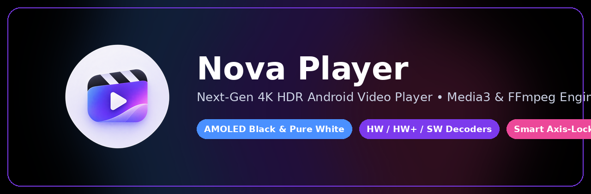

<div align="center">



<br />


# Nova Player

**Next-Generation Native Android Video Player — AMOLED Pitch Black, Fluid Glass UI & Hardware-Accelerated Media3 Engine**

[](https://github.com/xboyrex/DarkPlayer/actions)
[](https://github.com/xboyrex/DarkPlayer/releases/latest)
[](https://kotlinlang.org)
[](https://developer.android.com/media/media3)
[](LICENSE)

</div>

---

## Highlights

| Pillar | Capabilities |
| :--- | :--- |
| **Smart Player HUD & Gestures** | Single center transport (`Prev \| Play/Pause \| Next`), axis-locked horizontal seek vs. vertical volume/brightness gestures, instant `0ms` consecutive `10s` double-tap skips, minimal `2x` hold capsule, and an in-player **UI Switcher** popup. |
| **Dual Theme & Accent Engine** | Strictly **AMOLED Pitch Black (`#000000`)** and **Pure White (`#FFFFFF`)** surfaces paired with either the **Nova Logo Gradient (`#4A90FF → #7C3AED → #EC4899`)** or **Device Dynamic Accent (Material You)**. |
| **Hardware + FFmpeg Playback** | Media3 ExoPlayer `1.9.2` with bundled FFmpeg software audio/video decoders (`HW` / `HW+` / `SW`), 5-band Studio Equalizer, Bass Boost, Virtualizer, and up to `200%` Volume Boost (`0–30` scale). |
| **Security & Storage Integrity** | Hardware-backed **Android Keystore AES-256-GCM** encryption for SMB/SFTP/WebDAV credentials, **PBKDF2-HMAC-SHA256 (`120,000` iterations)** Private Vault PIN with exponential lockout, Android 14+ selected-photos playlist protection, and multi-volume SD/USB discovery. |
| **Silent Verified OTA Updater** | Non-intrusive background update checker on launch with strict ABI matching, byte-length validation, and `SHA-256` digest verification before package installation. |

---

## Project Architecture

```text
NovaPlayer (dev.xboyrex.darkplayer)
├── app/                        # Main entry point, adaptive navigation & silent OTA updater
├── core/
│   ├── common/                 # Multi-volume storage scanner, charset detector & extensions
│   ├── data/                   # Repositories, Keystore AES-256-GCM store & PBKDF2 Vault PIN
│   ├── database/               # Room database, DAOs & entity schemas
│   ├── datastore/              # Proto/JSON DataStore preferences
│   ├── domain/                 # Media sorting, grouping & synchronization use cases
│   ├── media/                  # LocalMediaSynchronizer, SMB/SFTP/WebDAV & thumbnail decoders
│   ├── model/                  # Immutable domain models & UI configuration enums
│   └── ui/                     # AMOLED/Pure White theme engine, fluid switches & glass bars
└── feature/
    ├── network/                # SMB, SFTP & WebDAV network streaming browser
    ├── player/                 # Media3 video player, smart gestures, EQ & UI Switcher popup
    ├── playlist/               # Custom playlists & watch history
    ├── settings/               # Appearance, Player, Audio, Subtitle, Gesture & About screens
    └── videopicker/            # Folders, Videos, Private Vault, Recycle Bin & Hub screens
```

---

## Building from Source

```bash
# Clone the repository
git clone https://github.com/xboyrex/DarkPlayer.git
cd DarkPlayer

# Run unit tests and assemble FOSS release APKs
chmod +x ./gradlew
./gradlew testDebugUnitTest :app:assembleRelease
```

### Custom Release Signing (Optional)

Provide your release keystore credentials via environment variables or `~/.gradle/gradle.properties`:

```bash
export RELEASE_STORE_FILE="/path/to/release.jks"
export RELEASE_STORE_PASSWORD="your_store_password"
export RELEASE_KEY_ALIAS="your_key_alias"
export RELEASE_KEY_PASSWORD="your_key_password"
./gradlew :app:assembleRelease
```

---

## Credits & Maintainer

Crafted and maintained by **Mayank ([@xboyrex](https://github.com/xboyrex))**.  
Licensed under the [GNU General Public License v3.0](LICENSE).
