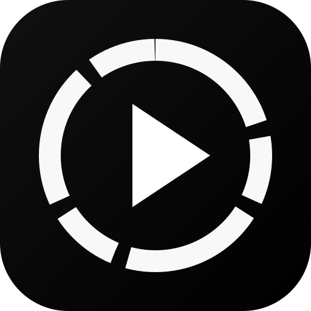
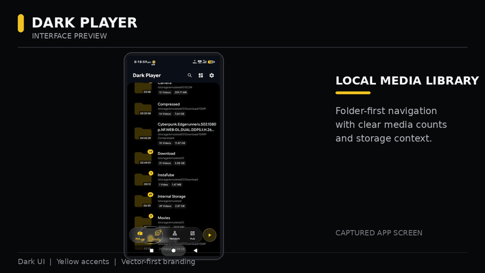
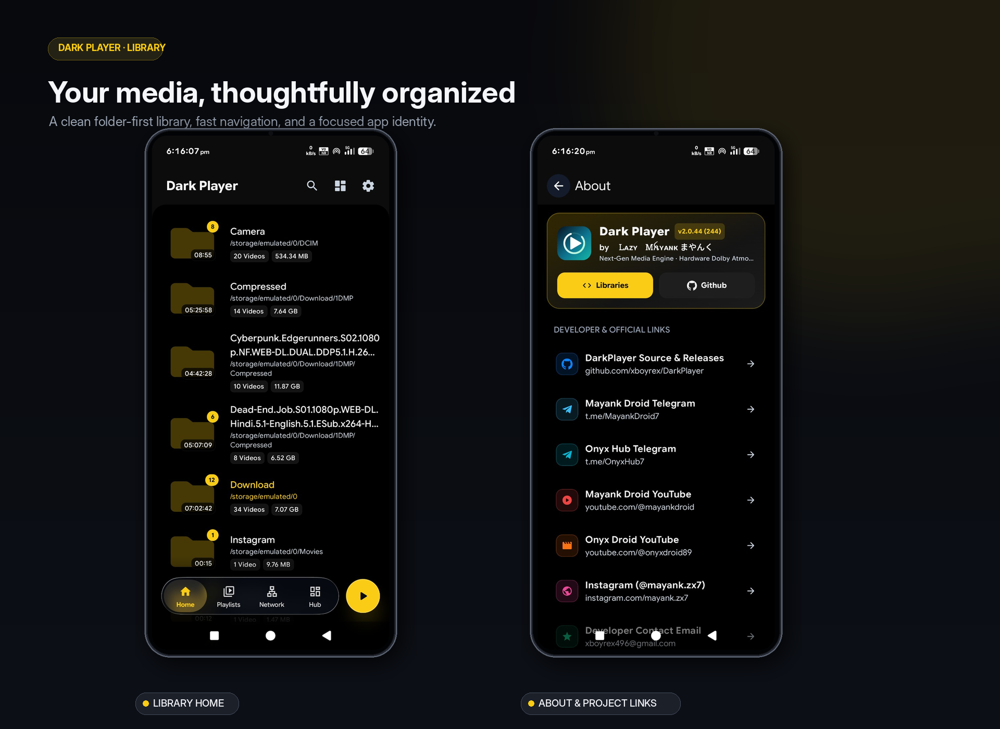
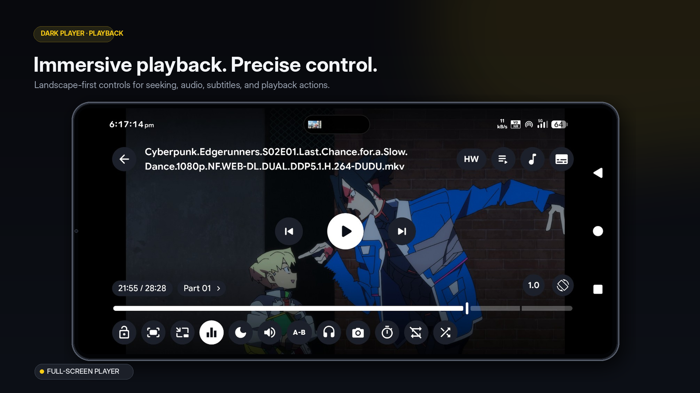
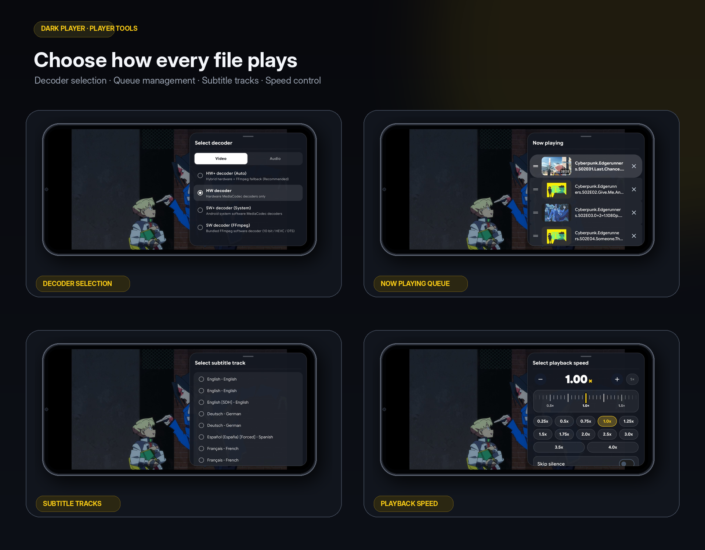

  
  <h1>Dark Player</h1>
  
<strong>A high-control Android video player for local libraries, network media, and deeply configurable playback.</strong>

  
Crafted by <strong>ㅤᏞᴀᴢʏㅤᎷꫝʏᴀɴк まやんく (<code>@xboyrex</code>)</strong> · Media3 / FFmpeg engine · 3-Layer Liquid Glass Nav & Player UI

  

    
    
    
    
  

  

    <a href="#features">Features</a> &nbsp;·&nbsp;
    <a href="#interface-preview">Interface preview</a> &nbsp;·&nbsp;
    <a href="#screenshots">Screenshots</a> &nbsp;·&nbsp;
    <a href="#installation">Installation</a> &nbsp;·&nbsp;
    <a href="#developer-links">Developer links</a>
  

---

## Interface preview

  

## Overview

**Dark Player** is an Android video player built on Media3 and FFmpeg (`nextlib`), featuring a 3-layer refractive **Liquid Glass** navigation bar and video player UI, a clean **0–200% Hardware LoudnessEnhancer Volume Booster**, an interactive haptic speed ruler (`0.25×–4.0×`), conflict-free angle-locked playback gestures, and an in-app GitHub Releases OTA auto-updater.

## Features

<table>
  <tr>
    <td width="50%" valign="top">
      
      <h3>Local media library</h3>
      Folder-first browsing, media counts, storage context, and instant hardware-accelerated thumbnails across Light, Dark, and AMOLED themes.
    </td>
    <td width="50%" valign="top">
      
      <h3>Liquid Glass player & controls</h3>
      Refractive Liquid Glass controls, shape-morphing Play/Pause button, double-tap SeekBurstPill with particle sparks, 2× hold-speed pill, and interactive haptic speed ruler.
    </td>
  </tr>
  <tr>
    <td width="50%" valign="top">
      
      <h3>Network media</h3>
      Direct SMB, FTP, SFTP, and WebDAV browsing and streaming plus external intent API support with custom HTTP headers.
    </td>
    <td width="50%" valign="top">
      
      <h3>200% Volume Boost & Subtitles</h3>
      Clean 0–200% hardware LoudnessEnhancer volume boost (`2000 mB`), multi-track audio/subtitle switching, and embedded ASS/SSA styling.
    </td>
  </tr>
  <tr>
    <td width="50%" valign="top">
      
      <h3>Playlists & Background Play</h3>
      Custom playlists, M3U import, Picture-in-Picture (PiP), and seamless background audio playback with URI permission retention.
    </td>
    <td width="50%" valign="top">
      
      <h3>Studio Settings & Auto-Updater</h3>
      Floating blurred studio sheets for Theme Mode (System / Dark / Light / AMOLED), Color Palette Picker, real-time Storage Analyzer, and automatic GitHub OTA updates.
    </td>
  </tr>
</table>

## Screenshots

  
  
<strong>Library & app experience</strong> Folder-first browsing, media counts, storage context, and developer information.

  
  
<strong>Immersive landscape playback</strong> Transport controls, seek timeline, playback gestures, and player actions.

  
  
<strong>Playback tools</strong> Decoder selection, Now Playing queue, subtitle tracks, and precision speed control.

> Store screenshots are also provided separately as unframed original device captures in `fastlane/metadata/android/en-US/images/phoneScreenshots/`.

## Installation

1. Open the [latest GitHub release](https://github.com/xboyrex/DarkPlayer/releases/latest).
2. Download the APK matching your device architecture (`arm64-v8a` for modern phones, `armeabi-v7a` for 32-bit devices, or `universal`).
3. Once installed, Dark Player automatically checks GitHub Releases and can download and install future updates directly inside the app.

## Developer links

- **Developer:** ㅤᏞᴀᴢʏㅤᎷꫝʏᴀɴк まやんく (`@xboyrex`)
- **Source & Releases:** [github.com/xboyrex/DarkPlayer](https://github.com/xboyrex/DarkPlayer)
- **GitHub Profile:** [github.com/xboyrex](https://github.com/xboyrex)
- **Instagram:** [instagram.com/mayank.zx7](https://www.instagram.com/mayank.zx7)
- **YouTube (Mayank Droid):** [youtube.com/@mayankdroid](https://youtube.com/@mayankdroid)
- **YouTube (Onyx Droid):** [youtube.com/@onyxdroid89](https://youtube.com/@onyxdroid89)
- **Telegram (MayankDroid7):** [t.me/MayankDroid7](https://t.me/MayankDroid7)
- **Telegram (OnyxHub7):** [t.me/OnyxHub7](https://t.me/OnyxHub7)
- **Email:** [xboyrex496@gmail.com](mailto:xboyrex496@gmail.com)
