

  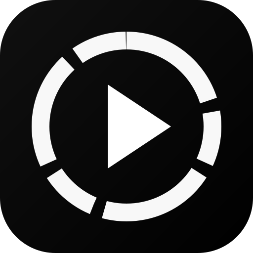
  <h1>Dark Player</h1>
  
<strong>A high-control Android video player for local libraries, network media, and deeply configurable playback.</strong>

  
NextLib + Media3 / FFmpeg engine · Dark-first interface · Liquid Glass-inspired surfaces

  

    
    
    
    
  

  

    <a href="#features">Features</a> &nbsp;·&nbsp;
    <a href="#interface-preview">Interface preview</a> &nbsp;·&nbsp;
    <a href="#screenshots">Screenshots</a> &nbsp;·&nbsp;
    <a href="#installation">Installation</a> &nbsp;·&nbsp;
    <a href="#project-links">Project links</a>
  

---

## Interface preview

  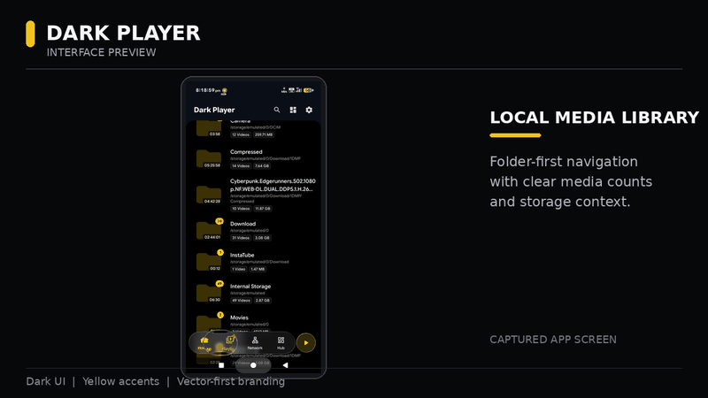
  
Animated overview assembled from the supplied app screenshots. It demonstrates captured screens, not a live recording of interactions.

## Overview

**Dark Player** is an Android video-player project focused on direct access to media, configurable playback, and a high-contrast dark interface. The supplied UI captures show a folder-oriented media library, a dedicated Hub, full-screen playback controls, subtitle and decoder selectors, network-stream setup, playlists, and granular settings.

The visual system uses black surfaces, restrained yellow accents, clear iconography, and compact navigation. The app-icon assets supplied with this repository package are preserved in their original Android, iOS, and web variants; an editable SVG mark is included for README and web use.

## Features

<table>
  <tr>
    <td width="50%" valign="top">
      
      <h3>Local media library</h3>
      Folder-first browsing, media counts, storage context, and a dedicated view for files within a folder.
    </td>
    <td width="50%" valign="top">
      
      <h3>Playback controls</h3>
      Full-screen landscape playback plus a decoder-selection interface captured in the supplied screenshots.
    </td>
  </tr>
  <tr>
    <td width="50%" valign="top">
      
      <h3>Network media</h3>
      The connection screen lists SMB, FTP, SFTP, and WebDAV for browsing and playing media over a network.
    </td>
    <td width="50%" valign="top">
      
      <h3>Audio and subtitles</h3>
      Dedicated subtitle-track selection and configurable audio/subtitle sections in Settings.
    </td>
  </tr>
  <tr>
    <td width="50%" valign="top">
      
      <h3>Playlists</h3>
      A separate Playlists destination; the empty-state copy references local playlists and M3U sources.
    </td>
    <td width="50%" valign="top">
      
      <h3>Audio hub</h3>
      A dedicated audio-booster panel is visible in the screenshots. Extreme gain may introduce clipping and unsafe listening levels.
    </td>
  </tr>
  <tr>
    <td width="50%" valign="top">
      
      <h3>Granular settings</h3>
      Player, gestures, audio, subtitles, appearance, media library, general, and About sections.
    </td>
    <td width="50%" valign="top">
      
      <h3>Hub shortcuts</h3>
      The captured Hub screen surfaces Vault, file picking, stream URL, auto-update, trash, and app settings entries.
    </td>
  </tr>
</table>

## Screenshots

All 16 supplied screenshots are included below and stored under [`docs/assets/dark-player/screenshots`](docs/assets/dark-player/screenshots). Open any image in a new tab for full resolution.

### Library and navigation

<table>
  <tr>
    <td align="center" width="33%">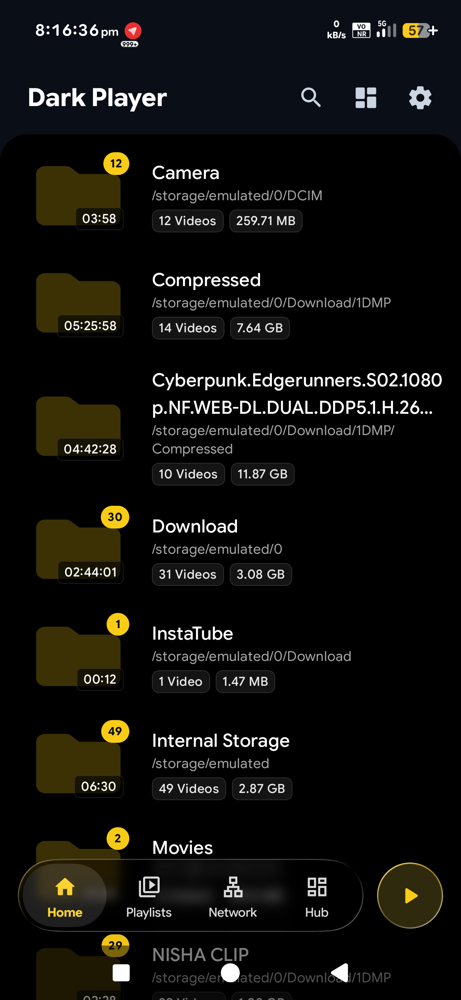 Library home</td>
    <td align="center" width="33%">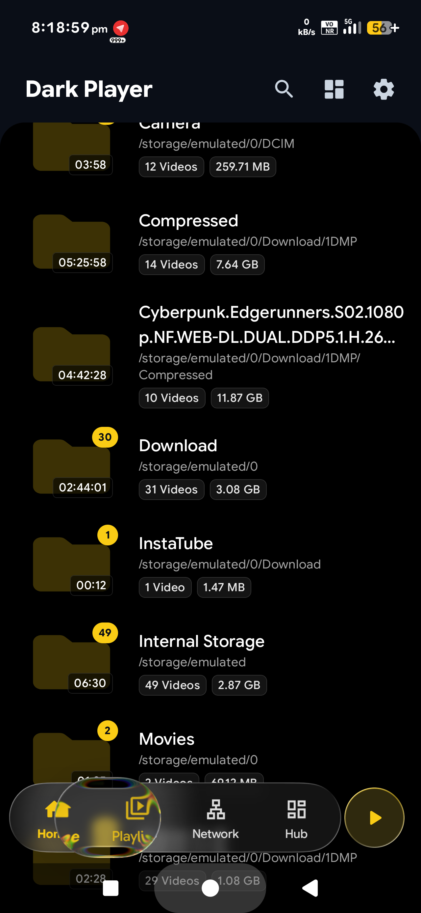 Main library</td>
    <td align="center" width="33%">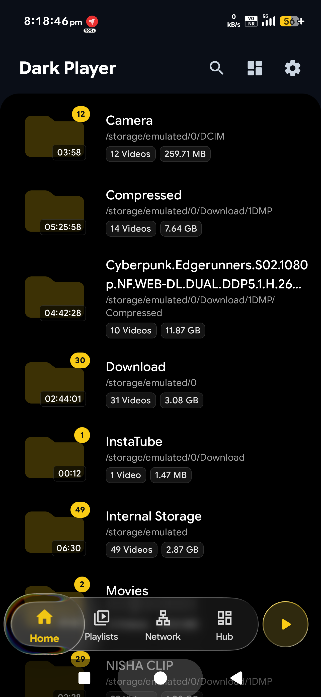 Compact library view</td>
  </tr>
  <tr>
    <td align="center">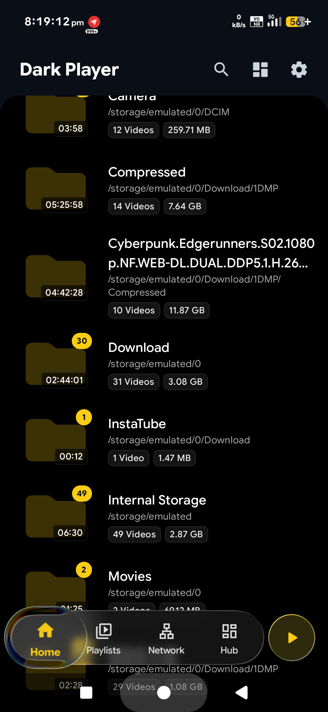 Library navigation</td>
    <td align="center">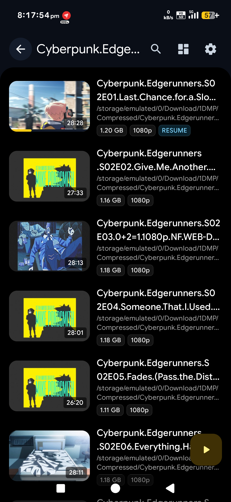 Folder video list</td>
    <td align="center">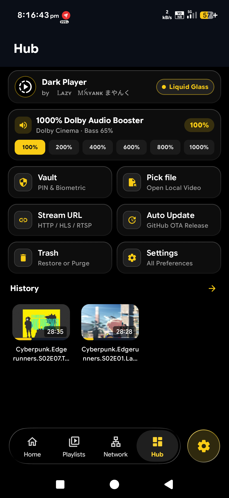 Hub and shortcuts</td>
  </tr>
</table>

### Playback and media controls

<table>
  <tr>
    <td align="center" width="50%">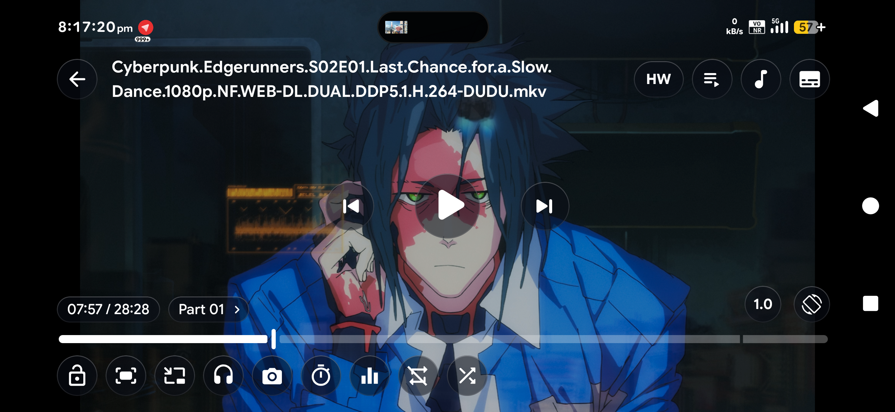 Landscape playback</td>
    <td align="center" width="50%">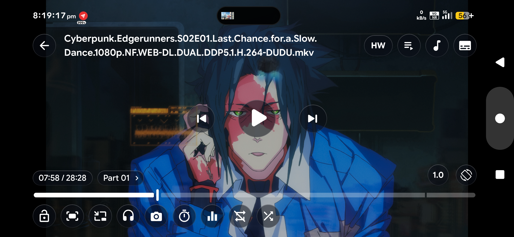 Playback controls</td>
  </tr>
  <tr>
    <td align="center">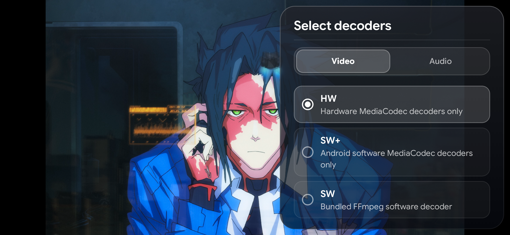 Decoder selection</td>
    <td align="center">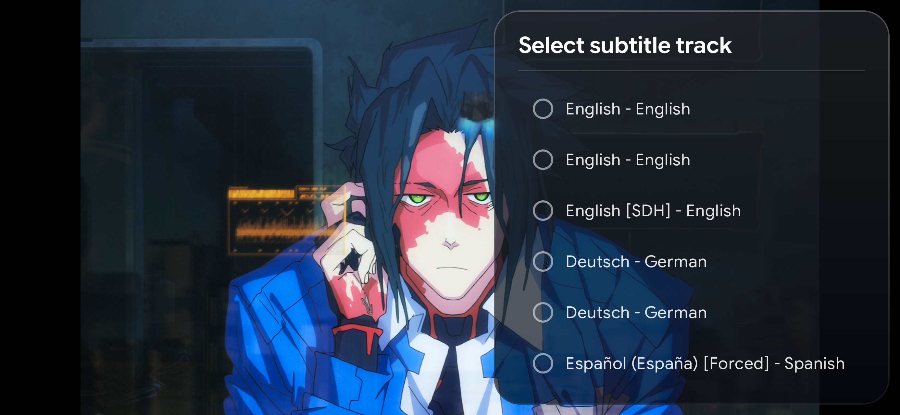 Subtitle selection</td>
  </tr>
  <tr>
    <td align="center">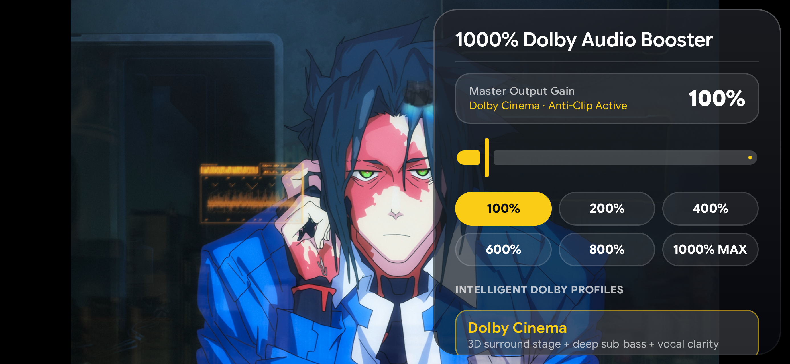 Audio booster panel</td>
    <td align="center">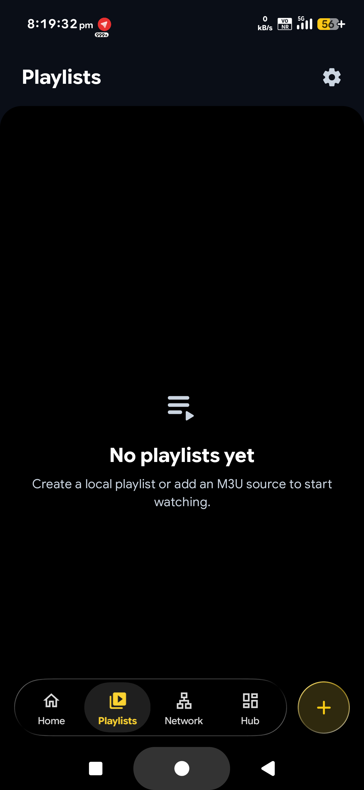 Playlists empty state</td>
  </tr>
</table>

### Network, settings, and about

<table>
  <tr>
    <td align="center" width="33%">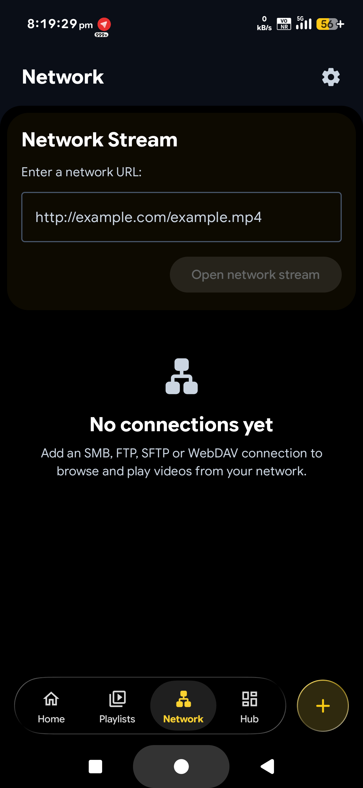 Network stream</td>
    <td align="center" width="33%">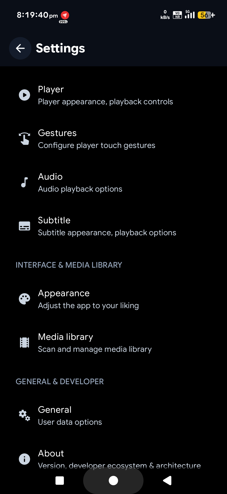 Settings</td>
    <td align="center" width="33%">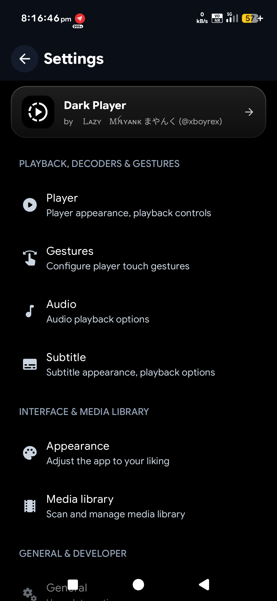 Settings categories</td>
  </tr>
  <tr>
    <td align="center">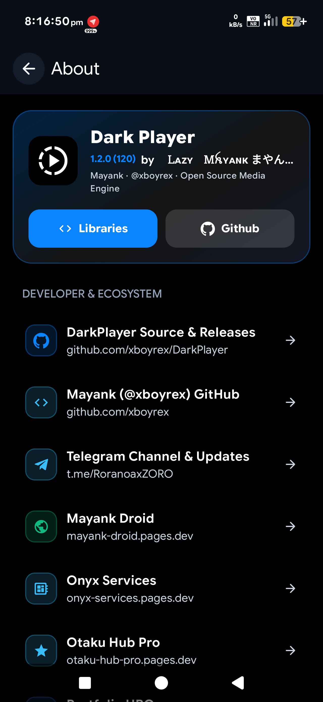 About and project links</td>
    <td align="center" colspan="2"> Supplied app icon</td>
  </tr>
</table>

## Visual identity

- **Palette:** black and charcoal surfaces with yellow accents, reflecting the supplied UI captures.
- **Iconography:** local SVG line icons for the feature overview and an editable SVG app mark.
- **Motion:** the showcase GIF cycles through actual supplied screenshots with restrained crossfades. It is a README presentation asset, not a claim about in-app animation behavior.
- **App icons:** original IconKitchen output is retained in [`assets/app-icons/icon-kitchen`](assets/app-icons/icon-kitchen), including Android mipmap variants, iOS app icons, and web icons.

## Installation

1. Open the [latest GitHub release](https://github.com/xboyrex/DarkPlayer/releases/latest).
2. Download the Android package attached to the release, if one is published.
3. Install it on a compatible Android device. Android may ask you to approve installation from your selected download source.

If the Releases page has no installable package, use the repository's current build instructions rather than assuming an APK is available.

## Project links

- **Source and releases:** [github.com/xboyrex/DarkPlayer](https://github.com/xboyrex/DarkPlayer)
- **Maintainer profile:** [github.com/xboyrex](https://github.com/xboyrex)
- **Telegram updates:** [t.me/AnmolK2200](https://t.me/AnmolK2200)
- **Mayank Droid:** [mayank-droid.pages.dev](https://mayank-droid.pages.dev)
- **Onyx Services:** [onyx-services.pages.dev](https://onyx-services.pages.dev)
- **Otaku Hub:** [otaku-hub.pages.dev](https://otaku-hub.pages.dev)

For bugs or feature requests, use the repository's [GitHub Issues](https://github.com/xboyrex/DarkPlayer/issues) page.

## Update and publish documentation

The repository includes a guarded Termux publisher for maintainers. After downloading and extracting the documentation pack, run `bash START-TERMUX.sh`. The script backs up the current README and package-owned asset folders, stages only the documentation paths, checks the staged changes, then asks before committing and pushing. It does not alter Android source code or build an APK. See [`README-PUSH-TERMUX.md`](README-PUSH-TERMUX.md) for authentication and recovery details.

## Repository notes

This README pack is a documentation and branding overlay. It does not contain the Android application source code or build outputs. The feature summary is based on the supplied description and the screenshots included with this pack; verify code-level availability against the current app source before treating every visible control as a production-ready feature.

No license terms are asserted here. Follow the repository's `LICENSE` file, if present, before redistributing the app or its assets.

---

  Dark Player · Documentation and screenshot refresh

